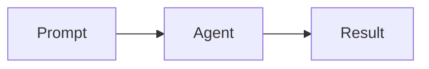

# Markdown in transcripts

Assistant replies render Markdown both while streaming and after completion.
The shared renderer also handles insight callouts, subagent results, and web
results, including archived transcripts and the assistant drawer.

Supported syntax includes CommonMark headings, emphasis, lists, blockquotes,
links, images, horizontal rules, and code; GitHub-style tables, task lists,
strikethrough, autolinks, and footnotes; and inline `$...$` / display `$$...$$`
math. Code fences retain syntax highlighting. Local footnote links stay in the
current message; external links open in a separate tab.

Fenced Mermaid blocks render in place once the text block finishes streaming:

````markdown

````

Mermaid loads on demand. Each diagram has an expandable source view; malformed
or unsupported diagrams keep their source visible instead of breaking the reply.
The generated SVG is displayed as an image, so diagram links and scripts are
inactive. Mermaid runs with strict security settings.

Safe embedded HTML such as `details`, `summary`, `kbd`, `sup`, and `sub` is
supported. Author HTML passes through the GitHub-style `rehype-sanitize` allowlist
before math and syntax highlighting. Scripts, event handlers, iframes, and unsafe
URL schemes are not supported. This is Markdown rendering, not executable MDX.
